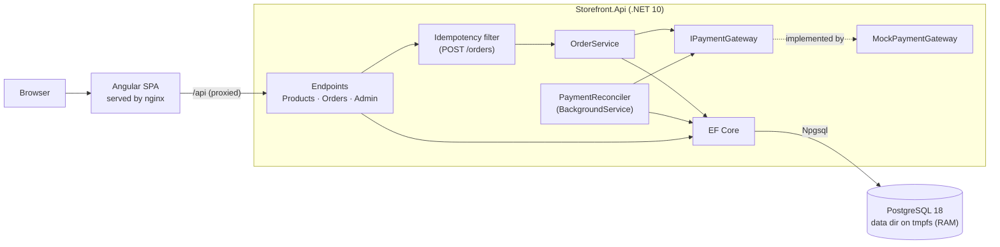
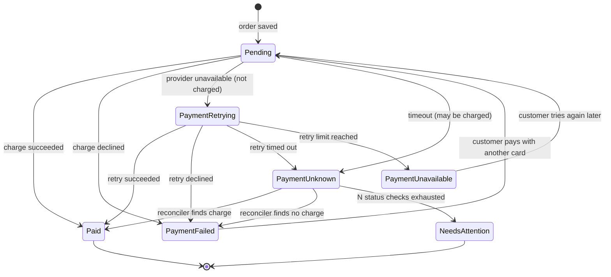
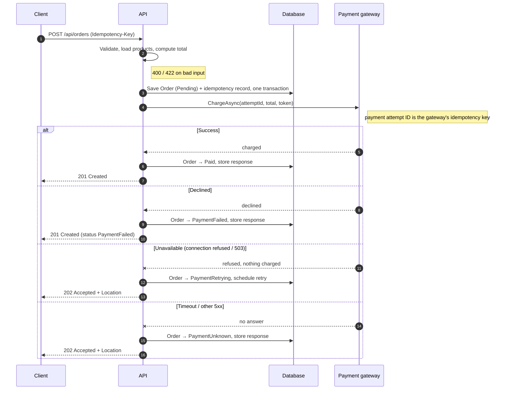
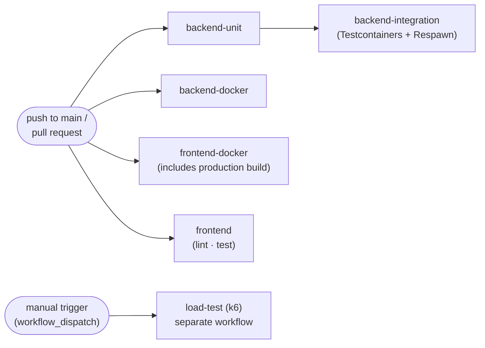

# Architecture — Storefront

A minimal storefront: a .NET API and an Angular client. Users browse products, place orders (with a mocked payment step) and look orders up; admins create and delete products.

The brief asks for a lightweight implementation that **could later handle real financial transactions**, and that behaves **predictably under repeated requests and partial failures**. Those two constraints drive most of the decisions below.

---

## 1. Overview



Three containers locally (`web`, `api`, `db`). No message broker, no separate payment service.

**One database engine everywhere.** The app, the integration tests and CI all run PostgreSQL with its data directory on a `tmpfs` (RAM) mount. That gives the in-memory behaviour the brief allows (fast, reset on restart) while running on the same engine the system would use with real money.

## 2. Technology choices

| Concern | Choice | Why |
|---|---|---|
| Backend | .NET 10, ASP.NET Core Minimal APIs | Required by the brief; current LTS; minimal APIs keep endpoint code small and explicit. |
| Persistence | EF Core 10 + `Npgsql.EntityFrameworkCore.PostgreSQL` | Official PostgreSQL provider; migrations, unique-constraint errors and row versioning all supported. |
| Database | PostgreSQL 18, data directory on **tmpfs**, durability off | In-memory in practice (RAM, reset on restart) as the brief allows, but with real transactions, constraints and concurrent writers. See §8. |
| Test database | Same image via **Testcontainers**, reset with **Respawn** | Tests run on exactly what the app runs on; the concurrency tests exercise real parallel transactions. |
| API docs | `Microsoft.AspNetCore.OpenApi` + Swagger UI at `/swagger` | Call every endpoint manually, including admin ones via the bearer token. |
| Validation | FluentValidation | Rules live next to the request types and are unit-testable. |
| Errors | ProblemDetails (RFC 9457) | One consistent, machine-readable error shape. |
| Auth | JWT bearer, `Admin` policy | Lightweight; replaceable with a real identity provider without touching endpoints. |
| Frontend | Angular (standalone components, signals) | Required by the brief. |
| CI | GitHub Actions | Runs unit + integration tests on every push to `main`; load test on demand. |

## 3. Repository layout

```
/
├── backend/
│   ├── src/Storefront.Api/
│   │   ├── Features/
│   │   │   ├── Products/        # list, create, delete (+ validators)
│   │   │   ├── Orders/          # create, get, OrderService, state machine
│   │   │   └── Auth/            # dev-only token endpoint
│   │   ├── Payments/            # IPaymentGateway, MockPaymentGateway, PaymentReconciler
│   │   ├── Idempotency/         # filter, record entity, request hashing
│   │   ├── Persistence/         # DbContext, entity configs, seeder, Migrations/
│   │   └── Program.cs
│   ├── tests/Storefront.UnitTests/
│   ├── tests/Storefront.IntegrationTests/
│   └── Dockerfile
├── frontend/                    # Angular app + Dockerfile + nginx.conf
├── ui-kit/                      # storefront CSS/JS kit, no dependencies, no build step
│   ├── storefront.css           # design tokens + all components (sf- prefix)
│   ├── storefront.js            # helpers: formatMoney, orderStatus, modal, toast, withBusy
│   ├── storefront.d.ts          # types so strict TypeScript / Angular can import the helpers
│   ├── demo.html                # every component on one page, for preview
│   └── README.md                # usage in plain HTML and Angular
├── loadtests/                   # k6 scripts
├── .github/workflows/
│   ├── ci.yml                   # every push
│   └── load-test.yml            # manual only
├── docker-compose.yml
├── ARCHITECTURE.md
├── AI_USAGE.md                  # journal of how AI was used
└── README.md
```

`ui-kit/` sits at the root for now so it can be previewed on its own (`npx serve ui-kit`). When the Angular app is scaffolded it moves to `frontend/src/ui-kit/` and `storefront.css` is listed first under `styles` in `angular.json`.

One API project organised by feature. Splitting into Domain / Application / Infrastructure projects adds ceremony without benefit at this size; it is the natural next step if the codebase grows.

## 4. Domain model

```
Product      Id, Name, Description, Price (Money), IsDeleted, CreatedAt
Order        Id, Status, Total (Money), FailureReason,
             CreatedAt, UpdatedAt, Version (xmin), Lines[], Payments[]
OrderLine    ProductId, ProductName, UnitPrice (Money), Quantity   ← snapshot
PaymentAttempt
             Id, OrderId, Number, PaymentToken, Status, FailureReason,
             ChargeCalls, NextCallAt, ChargeId, CreatedAt
Idempotency  Key (unique), RequestHash, OrderId, ResponseStatus,
             ResponseBody, State (InProgress | Completed), CreatedAt
```

- **Money** is stored as integer **minor units** (`long` cents) plus a currency code. No floating-point rounding anywhere. Single currency (GBP) assumed.
- **Optimistic concurrency on orders:** `Order.Version` is mapped to PostgreSQL's system column `xmin` (`IsRowVersion()`), so no extra column is needed. If the checkout request and the reconciler update the same order at once, the second save fails with `DbUpdateConcurrencyException` instead of silently overwriting the first; the loser reloads and re-applies its transition (which the state machine may then reject).
- **Order lines snapshot** name and unit price at purchase time, so later catalog edits or deletions never rewrite history.
- **Products are soft-deleted**: hidden from the catalog and rejected for new orders, but still resolvable from old orders.
- **One order, several payment attempts.** Paying again with another card adds a `PaymentAttempt`; the order and its total stay the same. The attempt's `Id` is the idempotency key sent to the provider, so retries of one attempt can never charge twice, while a new attempt (new card) is a genuinely new charge. `ChargeCalls` and `NextCallAt` drive the background retry schedule (§7).
- **Prices are never taken from the client.** The client sends product IDs and quantities; the server computes the total.

### Order state machine



`PaymentFailed` and `PaymentUnavailable` are not terminal: in both, the customer has **not been charged**, so they may start a new payment attempt on the same order (`POST /api/orders/{id}/payments`). `Paid` and `NeedsAttention` are terminal.

Transitions live in the `Order` entity (`MarkPaid()`, `MarkFailed(reason)`, …) and throw on illegal moves, so no code path can, for example, mark a `Paid` order as failed.

## 5. API

| Method | Route | Auth | Success | Notes |
|---|---|---|---|---|
| GET | `/api/products` | public | 200 | Excludes soft-deleted products |
| POST | `/api/orders` | public | 201 / 202 | Requires `Idempotency-Key` header |
| GET | `/api/orders/{id}` | public | 200 | 404 if unknown |
| POST | `/api/orders/{id}/payments` | public | 201 / 202 | New payment attempt (e.g. another card). Requires `Idempotency-Key`. Only from `PaymentFailed` or `PaymentUnavailable`; otherwise **409** |
| POST | `/api/admin/products` | Admin | 201 + `Location` | Validated |
| DELETE | `/api/admin/products/{id}` | Admin | 204 | Soft delete; idempotent (deleting twice is still 204) |
| POST | `/api/auth/token` | public, **Development only** | 200 | Hardcoded `admin` / `customer` users |

Order IDs are GUIDs, so they cannot be enumerated. In production, order retrieval would be scoped to the authenticated customer.

## 6. Repeated requests — idempotency

The client generates one UUID per checkout attempt and sends it as `Idempotency-Key`. A double-click, a network retry or a refresh reuses the same key.

| Situation | Response |
|---|---|
| Header missing or not a UUID | **400** ProblemDetails |
| New key | Process; store key, request hash and final response |
| Same key, same body, completed | **Replay the stored response** (same status, same body), plus `Idempotent-Replayed: true` |
| Same key, different body | **422** — key reused with a different payload |
| Same key, first request still in progress | **409** with `Retry-After: 1` |

**Concurrency:** the key column has a **unique index**. The first request inserts an `InProgress` record; a concurrent request with the same key hits the constraint violation and gets 409 or the stored replay. Correctness comes from the database, not from in-process locks, so it still holds with several API instances. The `InProgress` record is committed in its own short transaction before the gateway is called, so concurrent requests see it immediately. A violation surfaces as `PostgresException` with `SqlState == PostgresErrorCodes.UniqueViolation` (`23505`), detected in one helper.

The request hash is SHA-256 over a canonical form of the body (lines sorted by product ID).

## 7. Partial failures — payment flow



| Gateway outcome | Order status | HTTP |
|---|---|---|
| Success | `Paid` | **201 Created** |
| Declined | `PaymentFailed` (+ reason) | **201 Created** — the order exists; the client shows "payment declined" |
| Unavailable (connection refused, 503) | `PaymentRetrying` | **202 Accepted** + `Location: /api/orders/{id}` |
| Timeout / other 5xx | `PaymentUnknown` | **202 Accepted** + `Location: /api/orders/{id}` |

Why 202 for timeouts: after a timeout the charge **may have succeeded**. Reporting failure would invite the customer to pay twice. The honest answer is "accepted, outcome pending", and the client polls the order.

Why the order is saved **before** calling the gateway: if the process crashes mid-call, the order and its idempotency record still exist, and the reconciler can resolve it.

Why a separate state for "unavailable": when the provider refuses the connection or answers 503, we **know** nothing was charged. Retrying is then safe, and so is telling the customer "you have not been charged". A timeout gives no such certainty, so the two are never mixed.

**Gateway calls** use a short timeout (configurable, default 3 s). The request thread calls the provider **once** and never waits through retries, so the customer gets an answer in seconds.

### Retry policy for an unavailable provider

The reconciler retries the **same payment attempt with the same idempotency key**, with exponential backoff, until the provider answers or the limit is reached. A provider honouring idempotency keys cannot charge twice, even if an earlier "refused" call had in fact reached it.

| Setting | Default | Meaning |
|---|---|---|
| `Payments:Retry:MaxChargeAttempts` | 6 | Calls per attempt, first inline call included |
| `Payments:Retry:InitialDelay` | 2 s | Delay before the first retry |
| `Payments:Retry:BackoffMultiplier` | 2 | Each delay doubles |
| `Payments:Retry:MaxDelay` | 1 min | Cap on a single delay |

With the defaults, calls happen at 0, 2, 6, 14, 30 and 62 s. A 30-second outage is ridden out and the customer sees `Paid`. A long outage ends in `PaymentUnavailable` after about a minute, with `charged: false` and reason `payment_provider_unavailable`: the client tells the customer the payment provider is unavailable at the moment, that they have not been charged, and that they can try again. **Declines are never retried automatically**: they are the bank's final answer.

### PaymentReconciler

A `BackgroundService` that every few seconds calls `IPaymentReconciler.RunOnceAsync`, which processes every payment attempt that is due:

- **`PaymentRetrying`**: charges again with the same idempotency key, following the retry policy above. After the last allowed call, the order becomes `PaymentUnavailable`.
- **`PaymentUnknown`**: calls `IPaymentGateway.GetStatusAsync(attemptId)` only. It **never charges again**, because the first charge may have gone through. It applies backoff per attempt and moves the order to `NeedsAttention` after a configurable number of checks.

Keeping the pass in `RunOnceAsync`, separate from the loop, lets the integration tests drive it step by step against a fake clock.

**On queues:** the orders table *is* the durable work queue here. A broker (RabbitMQ, Azure Service Bus) would replace the polling loop once there are multiple instances, real money, or other consumers of payment events. Because the database lives in RAM, unresolved orders are lost if the `db` container restarts (an API restart alone loses nothing). That is acceptable for this exercise and listed as a trade-off.

### Mock payment gateway

`MockPaymentGateway : IPaymentGateway`, registered in DI. Outcomes are chosen by the `paymentToken` in the order request, so every path can be demonstrated from Swagger or the UI:

| Token | Behaviour |
|---|---|
| `tok_success` | Charge succeeds |
| `tok_decline` | Declined (`insufficient_funds`) |
| `tok_timeout` | Hangs past the timeout; charge actually **succeeded** (reconciler finds `Paid`) |
| `tok_error` | Returns an error; no charge made (reconciler finds `PaymentFailed`) |
| `tok_unavailable` | Provider refuses every call; nothing charged (ends in `PaymentUnavailable`) |
| `tok_flaky` | Status unavailable for the first two reconciler checks, then `Paid` |

The mock records charges keyed by idempotency key (the payment attempt ID), so a repeated charge is never applied twice and `GetStatusAsync` reports the truth. Swapping in a real provider means one new `IPaymentGateway` implementation.

## 8. Persistence

### PostgreSQL on tmpfs

The ORM is unaware of the tmpfs: EF Core talks to an ordinary PostgreSQL server over a normal connection. Only the container configuration differs from a persistent setup.

```yaml
# docker-compose.yml (excerpt)
db:
  image: postgres:18-alpine          # pin the exact minor tag when scaffolding
  environment:
    POSTGRES_DB: storefront
    POSTGRES_USER: storefront
    POSTGRES_PASSWORD: storefront    # local only
  command: >
    postgres -c fsync=off -c synchronous_commit=off -c full_page_writes=off
  tmpfs:
    - /var/lib/postgresql:size=512m
  healthcheck:
    test: ["CMD-SHELL", "pg_isready -U storefront -d storefront"]
    interval: 2s
    retries: 15
api:
  depends_on:
    db: { condition: service_healthy }
```

- **Mount point:** from PostgreSQL 18 the official image keeps data under a version-specific directory below `/var/lib/postgresql` instead of `/var/lib/postgresql/data`. Mounting the tmpfs at `/var/lib/postgresql` covers both layouts; mounting at the old path would silently leave data on the container's disk.
- **Durability off** (`fsync`, `synchronous_commit`, `full_page_writes`): pointless for a RAM-backed throwaway database, and it removes disk-flush latency. These settings must never reach a persistent deployment.
- **Health check:** the API starts only once PostgreSQL accepts connections.

### Schema and data

- **EF Core migrations** live in `Persistence/Migrations`. With a single provider they stay simple, and they are the same artifact a persistent deployment would use.
- On startup the API runs `Database.MigrateAsync()`, then an idempotent `DbSeeder` inserts the hardcoded catalog if it is empty. Both happen before the API accepts requests. They are switched by `Database:MigrateOnStartup` and `Database:SeedOnStartup`: off in `appsettings.json`, on in `appsettings.Development.json` (used by `dotnet run` and Docker Compose) and in the integration tests. In a multi-instance production deployment, migrations would run as a separate pipeline step instead, and there would be no demo data.
- **Demo catalog** (`Persistence/DbSeeder.cs`): seven tiny houses plus one product that is seeded already soft-deleted, so the catalog visibly hides deleted products. IDs are fixed (`5eed0000-0000-4000-8000-0000000000NN`), so demos and tests can refer to products by ID. Seed products are built through `Product.Create`, the same factory the admin endpoint uses, so seed data cannot bypass validation.
- **Seeding is idempotent and safe to run concurrently.** It does nothing if any product exists, live or deleted, so restarting the API never duplicates the catalog. The catalog is inserted in one transaction. If two instances seed an empty database at the same time, the slower one hits a primary-key violation on the fixed IDs, rolls back and logs that the catalog was already seeded.
- Check constraints on `Products` (positive price, ISO 4217 currency) back up the domain rules at the database level.
- Unique index on `Idempotency.Key`; index on `Order.Status` for the reconciler's query.
- Connection string comes from `ConnectionStrings:Storefront` (environment variable in Docker, `appsettings.Development.json` pointing at `localhost:5432` for `dotnet run`).

## 9. Security

- JWT bearer authentication with a `role` claim; `Admin` policy on `/api/admin/*`.
- 401 without a token, 403 with a non-admin token.
- The token endpoint and its hardcoded users exist only in the Development environment.
- API docs (`/openapi/v1.json` and Swagger UI at `/swagger`) are public in every environment, so anyone can read the contract and send requests from the browser without logging in. Admin operations still need a bearer token, entered with **Authorize**. Set `ApiDocs:Enabled=false` to hide the docs on a public deployment.
- JSON numbers must be real numbers (`NumberHandling.Strict`): a price sent as `"1999"` is a 400, and the OpenAPI schema types numbers as `integer` only, which keeps the generated Angular client's types exact.
- Signing key comes from configuration (user secrets / environment variable), never committed.
- Input validation on every write endpoint: non-empty names, positive prices, quantities 1–100, at most 50 lines, no duplicate product IDs.

## 10. Error handling

- All errors return ProblemDetails with a stable `type` URI (e.g. `/errors/idempotency-key-reused`), a human-readable `detail`, and a `traceId`.
- Validation errors list per-field messages.
- A global exception handler returns 500 ProblemDetails without stack traces outside Development.

## 11. Frontend

- **Pages:** product list, cart, checkout, order details / lookup, admin products (route guarded by role).
- **Cart** is a signals-based service, persisted to `localStorage`.
- **Checkout** creates the idempotency key when the page opens and reuses it for retries. It disables the submit button while a request is in flight, shows each outcome distinctly, and polls `GET /api/orders/{id}` while the status is `PaymentUnknown`.
- An HTTP interceptor attaches the JWT and maps ProblemDetails to user-facing messages.
- Typed API client generated from the OpenAPI spec.
- Styling comes from `ui-kit/` (adapted from a free storefront HTML/CSS kit): global `sf-` classes, no Bootstrap. Components bind state in templates rather than calling the kit's DOM helpers; `formatMoney` backs a `money` pipe and `orderStatus` drives status badges, so the UI shares the API's minor-units money model and order states.

## 12. Testing strategy

### Unit tests — `Storefront.UnitTests` (xUnit)

Fast, no I/O. Only for logic that the integration tests cannot reach well through HTTP:
- **Order state machine:** every legal transition succeeds and every illegal one throws, as a table over all status pairs. Through the API only a few states can be set up on demand.
- **Request hashing:** equivalent bodies produce the same hash (lines in a different order, the same product split across two lines, formatting differences); different bodies do not. These cases decide whether a retry counts as the same request, and are tedious to set up over HTTP.
- **Money arithmetic:** line and order totals in minor units, currency mismatch rejected, no rounding drift.

Everything else is left to the integration tests on purpose: payment outcome mapping, reconciler decisions (resolve, back off, give up) and validation are already exercised end to end with the fake clock and scripted gateway, so unit tests there would duplicate them.

### Integration tests — `Storefront.IntegrationTests`

**xUnit + WebApplicationFactory + Testcontainers + Respawn.**

- **Testcontainers** starts one PostgreSQL container per test run, shared through an xUnit collection fixture. It uses the **same image, tmpfs mount and durability flags** as Docker Compose (`WithTmpfsMount("/var/lib/postgresql")`, `WithCommand("-c", "fsync=off", …)`), so tests run on exactly what the app runs on.
- **WebApplicationFactory** boots the real API in-process with the container's connection string. It replaces `TimeProvider` with a `FakeTimeProvider` and `IPaymentGateway` with a scripted fake whose declines and outages each test sets up. The reconciler loop is switched off; tests call `IPaymentReconciler.RunOnceAsync` while advancing the fake clock, so a two-hour outage runs in seconds and every retry happens at a known moment.
- **Migrations are applied once** per run. **Respawn** (`DbAdapter.Postgres`, ignoring `__EFMigrationsHistory`) deletes all rows before each test (`IAsyncLifetime`), then the test boots a fresh API instance, whose startup `DbSeeder` re-inserts the catalog. Each test starts from a known state without paying for a new container.
- Tests go through real HTTP with `HttpClient`.

Scenarios:
- Same `Idempotency-Key` twice → one order, identical responses, `Idempotent-Replayed: true` on the second.
- **10 parallel requests with one key → exactly one order**; the rest get 409 or the replayed response. These are genuinely concurrent transactions on PostgreSQL, so the test proves the unique-constraint design rather than passing by accident.
- Checkout and reconciler updating the same order concurrently → one wins, no lost update (`xmin` row version).
- Same key, different body → 422. Missing key → 400.
- Each payment token → expected status and HTTP code; `tok_timeout` resolves to `Paid` via the reconciler.
- **Checkout payment scenarios** (`Payments/CheckoutPaymentTests.cs`): paid first time; declined and abandoned (never retried automatically); declined then paid with another card on the same order; provider down for 30 s then `Paid`; provider down for hours → retry limit → `PaymentUnavailable`, not charged. Each also checks that the customer was charged at most once, for exactly the total. The contract these tests expect is in the test project's `README.md`.
- Ordering a deleted product → 422; old orders still show the deleted product's snapshot.
- Admin endpoints: 401 anonymous, 403 customer, 201/204 admin.
- Client-supplied prices are ignored.

**Why not an in-process in-memory database for tests?** The EF Core InMemory provider has no transactions or unique constraints, so the idempotency tests would pass without testing anything. SQLite in-memory enforces constraints but serialises all writers, so it cannot reproduce concurrent transactions. Running the same PostgreSQL-on-tmpfs container as the app costs a few seconds of container start-up per run and removes any gap between what is tested and what runs.

### Frontend tests

Angular unit tests (cart service, checkout component, interceptor) run with the Angular CLI test runner in CI.

### Load test — `loadtests/` (k6)

Not part of normal CI (see §13). Scenarios:
- **Browse:** ramping virtual users on `GET /api/products`.
- **Checkout:** users placing orders with unique keys and mixed tokens.
- **Retry storm:** many concurrent requests sharing a few keys, then a check that each key produced exactly one order.

Thresholds: p95 latency < 500 ms, error rate < 1% (excluding expected 409s).

## 13. CI — GitHub Actions

Work is pushed directly to `main`, so CI runs on **every push to `main`** (and on pull requests, should they be used later).

### `ci.yml` — every push

```yaml
on:
  push:
    branches: [main]
  pull_request:
    branches: [main]

```

There is deliberately **no `concurrency` block**: every push gets its own complete run, and a newer run never cancels an older one. Work goes straight to `main`, so each commit should end with its own pass or fail instead of the earlier one showing as `cancelled`. Runs triggered by quick successive pushes simply execute side by side. The cost is extra runner minutes. The manual load test is the opposite: it queues (`cancel-in-progress: false`), because two load tests at once would skew each other's numbers.

Four independent chains start together. The only ordering is inside the backend test chain: integration tests wait for unit tests.



| Job | Steps | Depends on |
|---|---|---|
| `backend-unit` | setup .NET 10 → restore → build → `dotnet test tests/Storefront.UnitTests` | — |
| `backend-integration` | setup .NET 10 → `dotnet test tests/Storefront.IntegrationTests` (Testcontainers uses the runner's Docker). Allowed to fail for now, see below | `backend-unit` |
| `backend-docker` | build `./backend` as `storefront-api:<commit SHA>` (no push) | — |
| `frontend-docker` | build `./frontend` as `storefront-web:<commit SHA>` (no push); its Dockerfile runs `ng build --configuration production`, so AOT errors and bundle budgets fail here | — |
| `frontend` | setup Node 22 → `npm ci` → lint → unit tests | — |

- **Integration after unit:** unit tests take seconds and need no Docker. If they fail, the integration tests would mostly report the same bug through HTTP, after a PostgreSQL container start. On a green run the cost is that integration tests start a few seconds later.
- **Docker builds don't wait for tests:** they check different things (Dockerfiles, packaging, the production build), and a failing test should not hide a broken image. Running them alongside the tests reports every failure in one run and keeps the wall-clock time to the longest chain.
- **The frontend is built once per run**, inside `frontend-docker`; the `frontend` job only lints and tests.
- Every job must pass for the run to be green, with one temporary exception: the integration tests were written before the backend (test-first) and fail until it is implemented, so `backend-integration` runs with `continue-on-error: true`. Its failures stay visible in the run; the flag is removed once the backend makes them pass.
- **Image tags:** each image is tagged with the full commit SHA (`github.sha`), so an image always maps to exactly one commit. Images are not pushed yet; pushing to a registry and moving a `latest` tag come later.
- **Actions pinned to commit SHAs:** every third-party action is referenced by its full commit SHA, with the version in a comment (`actions/checkout@<sha> # v5`). A tag can be moved to different code; a SHA cannot, which matters once the pipeline can deploy code that handles payments.
- Test results are published as TRX files and uploaded as artifacts, so failures are readable in the Actions UI.
- NuGet and npm caches are enabled; Docker layers use the GitHub Actions cache.
- `ubuntu-latest` runners include Docker, so Testcontainers needs no extra setup.

### `load-test.yml` — manual only

```yaml
on:
  workflow_dispatch:
    inputs:
      vus:      { description: "Virtual users", default: "50" }
      duration: { description: "Duration",      default: "2m" }
```

- A **separate workflow** triggered only with `workflow_dispatch`, so it can never block or slow the CI pipeline on push.
- Steps: start the stack with `docker compose up -d --build` → wait for `/health` → run k6 with the given inputs → upload the k6 summary as an artifact → `docker compose down`.
- Failing thresholds mark the load-test run red without affecting CI status.

### Trade-off of pushing to `main`

Tests run **after** code reaches `main`, so a broken commit can land. Acceptable for a solo exercise; for a team, the next step is short-lived branches with pull requests and branch protection requiring `ci.yml` to pass.

## 14. Running locally

```bash
docker compose up --build              # db, api and web
docker compose up --build web          # same: web pulls in api, which waits for db
```

| URL | What |
|---|---|
| http://localhost:4200 | Storefront |
| http://localhost:8080/swagger | API docs and manual calls |
| http://localhost:8080/openapi/v1.json | OpenAPI document (source for the Angular client) |
| http://localhost:8080/health | Health check |

nginx in the `web` container proxies `/api` to the `api` container, so the browser sees one origin and CORS is not needed. It re-resolves `api` through Docker's DNS, so rebuilding or restarting the API (`docker compose up -d --build api`) does not require restarting `web`. PostgreSQL is published on `127.0.0.1:5432` only, to inspect the database from the host.

**Developing outside containers:**

```bash
docker compose up -d db                             # database only, exposed on localhost:5432
dotnet run --project backend/src/Storefront.Api     # applies migrations, seeds catalog
cd frontend && npm start                            # dev proxy forwards /api
```

`docker compose restart db` (or `down`/`up`) resets the database to the seed data. Docker is required for both running the app and running the integration tests.

**Running the integration tests without a local .NET SDK:**

```bash
docker compose run --rm integration-tests      # .NET 10 SDK image; Testcontainers via the host's Docker socket
```

The `integration-tests` service sits under a `tests` Compose profile, so `docker compose up` (which starts `db` and `api`) never runs it. Build output and the NuGet cache live in named volumes, so Linux `bin/obj` never collide with an IDE's on the host.

## 15. Assumptions

- Single currency (GBP); no tax or shipping.
- No stock tracking; products are always available unless deleted.
- Anonymous checkout; orders are retrievable by ID.
- Authentication is mocked with hardcoded users for the exercise.
- A declined payment leaves the order `PaymentFailed`. The customer can pay the same order again with another card (a new payment attempt with a new key). Declines are never retried automatically.
- "Provider unavailable" (connection refused, 503) means nothing was charged; a timeout does not.
- Data is intentionally ephemeral: restarting the database container resets the store to its seed catalog.

## 16. Trade-offs and future work

| Decision | Trade-off | Next step for real money |
|---|---|---|
| PostgreSQL on tmpfs, durability off | State lost when the database container restarts, including unresolved payments; app needs Docker | Remove the tmpfs and durability flags, add a volume or managed PostgreSQL; migrations already exist |
| Migrations applied at app startup | Unsafe with many instances starting at once | Run migrations as a pipeline step |
| Background retries only for "unavailable", fixed retry limit | Customer gets an answer in about a minute but must retry themselves after a long outage; every order keeps hitting a provider that is down | Circuit breaker that fails fast while the provider is down; notify the customer when it recovers |
| Polling reconciler | Single instance, simple | Message broker + outbox for payment events |
| Mock auth | Not secure | External identity provider (OIDC) |
| Mock gateway | No real provider semantics (webhooks, 3DS) | Real provider integration via `IPaymentGateway`, webhook endpoint |
| Single API project | Less enforced layering | Split projects if domain grows |
| Push to `main` | Broken commits can land | PRs + branch protection |
| — | No observability | Structured logging, OpenTelemetry traces, alerting on `NeedsAttention` orders |
| — | No abuse protection | Rate limiting on order creation; idempotency record expiry |
