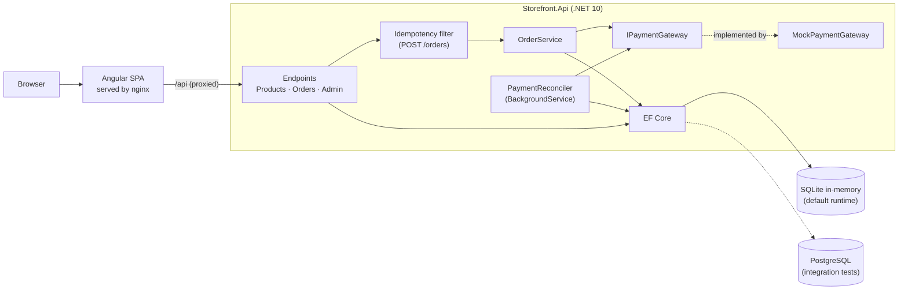
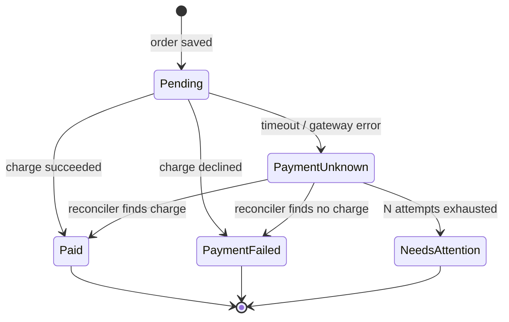
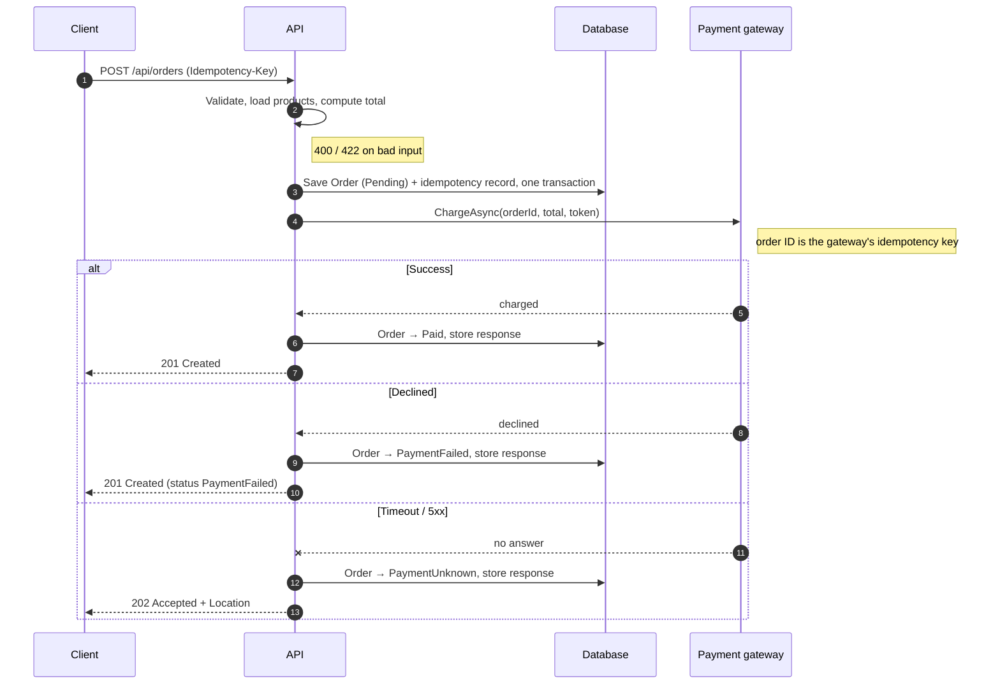
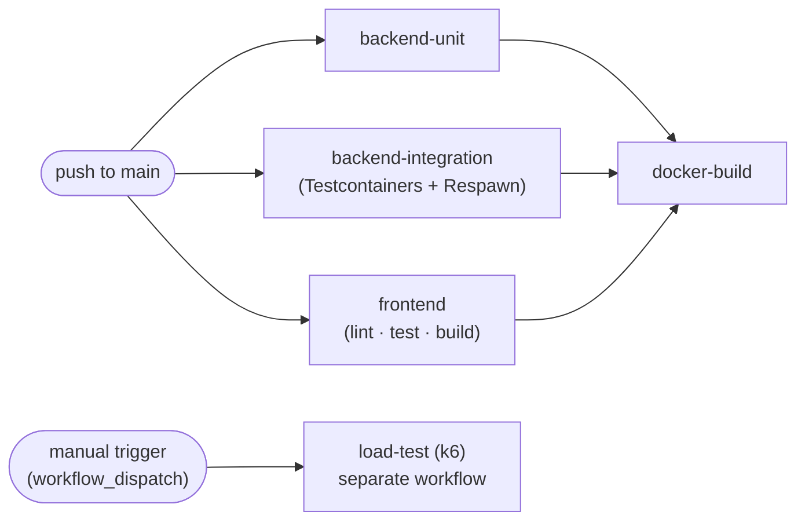

# Architecture — Storefront

A minimal storefront: a .NET API and an Angular client. Users browse products, place orders (with a mocked payment step) and look orders up; admins create and delete products.

The brief asks for a lightweight implementation that **could later handle real financial transactions**, and that behaves **predictably under repeated requests and partial failures**. Those two constraints drive most of the decisions below.

---

## 1. Overview



Two containers locally (`api`, `web`). No message broker, no separate payment service.

## 2. Technology choices

| Concern | Choice | Why |
|---|---|---|
| Backend | .NET 10, ASP.NET Core Minimal APIs | Required by the brief; current LTS; minimal APIs keep endpoint code small and explicit. |
| Persistence | EF Core | One model, swappable provider. |
| Runtime database | SQLite **in-memory** (shared, kept-open connection), seeded on startup | Brief allows in-memory. Unlike the EF Core InMemory provider, SQLite enforces **unique constraints and transactions**, which the idempotency design relies on. |
| Test database | PostgreSQL via **Testcontainers** | Proves the code runs on a production-grade database and makes the concurrency tests meaningful. |
| API docs | `Microsoft.AspNetCore.OpenApi` + Swagger UI at `/swagger` | Call every endpoint manually, including admin ones via the bearer token. |
| Validation | FluentValidation | Rules live next to the request types and are unit-testable. |
| Errors | ProblemDetails (RFC 9457) | One consistent, machine-readable error shape. |
| Auth | JWT bearer, `Admin` policy | Lightweight; replaceable with a real identity provider without touching endpoints. |
| Frontend | Angular (standalone components, signals) | Required by the brief. |
| CI | GitHub Actions | Runs unit + integration tests on every push to `main`; load test on demand. |

## 3. Repository layout

```
/
├── backend/
│   ├── src/Storefront.Api/
│   │   ├── Features/
│   │   │   ├── Products/        # list, create, delete (+ validators)
│   │   │   ├── Orders/          # create, get, OrderService, state machine
│   │   │   └── Auth/            # dev-only token endpoint
│   │   ├── Payments/            # IPaymentGateway, MockPaymentGateway, PaymentReconciler
│   │   ├── Idempotency/         # filter, record entity, request hashing
│   │   ├── Persistence/         # DbContext, seed data, provider selection
│   │   └── Program.cs
│   ├── tests/Storefront.UnitTests/
│   ├── tests/Storefront.IntegrationTests/
│   └── Dockerfile
├── frontend/                    # Angular app + Dockerfile + nginx.conf
├── loadtests/                   # k6 scripts
├── .github/workflows/
│   ├── ci.yml                   # every push
│   └── load-test.yml            # manual only
├── docker-compose.yml
├── ARCHITECTURE.md
└── README.md
```

One API project organised by feature. Splitting into Domain / Application / Infrastructure projects adds ceremony without benefit at this size; it is the natural next step if the codebase grows.

## 4. Domain model

```
Product      Id, Name, Description, Price (Money), IsDeleted, CreatedAt
Order        Id, Status, Total (Money), PaymentToken, FailureReason,
             PaymentAttempts, CreatedAt, UpdatedAt, Lines[]
OrderLine    ProductId, ProductName, UnitPrice (Money), Quantity   ← snapshot
Idempotency  Key (unique), RequestHash, OrderId, ResponseStatus,
             ResponseBody, State (InProgress | Completed), CreatedAt
```

- **Money** is stored as integer **minor units** (`long` cents) plus a currency code. No floating point, identical behaviour on SQLite and PostgreSQL. Single currency (GBP) assumed.
- **Order lines snapshot** name and unit price at purchase time, so later catalog edits or deletions never rewrite history.
- **Products are soft-deleted**: hidden from the catalog and rejected for new orders, but still resolvable from old orders.
- **Prices are never taken from the client.** The client sends product IDs and quantities; the server computes the total.

### Order state machine



Transitions live in the `Order` entity (`MarkPaid()`, `MarkFailed(reason)`, …) and throw on illegal moves, so no code path can, for example, mark a `Paid` order as failed.

## 5. API

| Method | Route | Auth | Success | Notes |
|---|---|---|---|---|
| GET | `/api/products` | public | 200 | Excludes soft-deleted products |
| POST | `/api/orders` | public | 201 / 202 | Requires `Idempotency-Key` header |
| GET | `/api/orders/{id}` | public | 200 | 404 if unknown |
| POST | `/api/admin/products` | Admin | 201 + `Location` | Validated |
| DELETE | `/api/admin/products/{id}` | Admin | 204 | Soft delete; idempotent (deleting twice is still 204) |
| POST | `/api/auth/token` | public, **Development only** | 200 | Hardcoded `admin` / `customer` users |

Order IDs are GUIDs, so they cannot be enumerated. In production, order retrieval would be scoped to the authenticated customer.

## 6. Repeated requests — idempotency

The client generates one UUID per checkout attempt and sends it as `Idempotency-Key`. A double-click, a network retry or a refresh reuses the same key.

| Situation | Response |
|---|---|
| Header missing or not a UUID | **400** ProblemDetails |
| New key | Process; store key, request hash and final response |
| Same key, same body, completed | **Replay the stored response** (same status, same body), plus `Idempotent-Replayed: true` |
| Same key, different body | **422** — key reused with a different payload |
| Same key, first request still in progress | **409** with `Retry-After: 1` |

**Concurrency:** the key column has a **unique index**. The first request inserts an `InProgress` record; a concurrent request with the same key hits the constraint violation and gets 409 or the stored replay. Correctness comes from the database, not from in-process locks, so it still holds with several API instances. Constraint violations are recognised per provider (SQLite code 19, PostgreSQL 23505) behind one helper.

The request hash is SHA-256 over a canonical form of the body (lines sorted by product ID).

## 7. Partial failures — payment flow



| Gateway outcome | Order status | HTTP |
|---|---|---|
| Success | `Paid` | **201 Created** |
| Declined | `PaymentFailed` (+ reason) | **201 Created** — the order exists; the client shows "payment declined" |
| Timeout / 5xx | `PaymentUnknown` | **202 Accepted** + `Location: /api/orders/{id}` |

Why 202 for timeouts: after a timeout the charge **may have succeeded**. Reporting failure would invite the customer to pay twice. The honest answer is "accepted, outcome pending", and the client polls the order.

Why the order is saved **before** calling the gateway: if the process crashes mid-call, the order and its idempotency record still exist, and the reconciler can resolve it.

**Gateway calls** use a short timeout (configurable, default 3 s). They are **not retried inline**: a blind retry of a charge is exactly what causes double payments.

### PaymentReconciler

A `BackgroundService` that polls for `PaymentUnknown` orders every few seconds and calls `IPaymentGateway.GetStatusAsync(orderId)`. It **never charges again**. It applies backoff per order and moves an order to `NeedsAttention` after a configurable number of attempts.

**On queues:** the orders table *is* the durable work queue here. A broker (RabbitMQ, Azure Service Bus) would replace the polling loop once there are multiple instances, real money, or other consumers of payment events. With an in-memory database, unresolved orders are lost on restart, which is acceptable for this exercise and listed as a trade-off.

### Mock payment gateway

`MockPaymentGateway : IPaymentGateway`, registered in DI. Outcomes are chosen by the `paymentToken` in the order request, so every path can be demonstrated from Swagger or the UI:

| Token | Behaviour |
|---|---|
| `tok_success` | Charge succeeds |
| `tok_decline` | Declined (`insufficient_funds`) |
| `tok_timeout` | Hangs past the timeout; charge actually **succeeded** (reconciler finds `Paid`) |
| `tok_error` | Returns an error; no charge made (reconciler finds `PaymentFailed`) |
| `tok_flaky` | Status unavailable for the first two reconciler checks, then `Paid` |

The mock records charges keyed by order ID, so a repeated charge is never applied twice and `GetStatusAsync` reports the truth. Swapping in a real provider means one new `IPaymentGateway` implementation.

## 8. Persistence

- `Database:Provider` setting selects `Sqlite` (default) or `Postgres`.
- **SQLite in-memory:** a single `SqliteConnection` to `DataSource=:memory:` is opened at startup and kept open for the app's lifetime (the database disappears when the last connection closes).
- Schema is created with `EnsureCreated()` and the catalog is seeded with hardcoded products. **No migrations** — trade-off: fine for in-memory and throwaway test containers; migrations would be added before any persistent deployment.
- The same EF model and queries run on both providers; provider-specific code is limited to connection setup and constraint-violation detection.

## 9. Security

- JWT bearer authentication with a `role` claim; `Admin` policy on `/api/admin/*`.
- 401 without a token, 403 with a non-admin token.
- The token endpoint and its hardcoded users exist only in the Development environment.
- Signing key comes from configuration (user secrets / environment variable), never committed.
- Input validation on every write endpoint: non-empty names, positive prices, quantities 1–100, at most 50 lines, no duplicate product IDs.

## 10. Error handling

- All errors return ProblemDetails with a stable `type` URI (e.g. `/errors/idempotency-key-reused`), a human-readable `detail`, and a `traceId`.
- Validation errors list per-field messages.
- A global exception handler returns 500 ProblemDetails without stack traces outside Development.

## 11. Frontend

- **Pages:** product list, cart, checkout, order details / lookup, admin products (route guarded by role).
- **Cart** is a signals-based service, persisted to `localStorage`.
- **Checkout** creates the idempotency key when the page opens and reuses it for retries. It disables the submit button while a request is in flight, shows each outcome distinctly, and polls `GET /api/orders/{id}` while the status is `PaymentUnknown`.
- An HTTP interceptor attaches the JWT and maps ProblemDetails to user-facing messages.
- Typed API client generated from the OpenAPI spec.
- Layout based on a free Bootstrap storefront template (Eshopper), ported into components.

## 12. Testing strategy

### Unit tests — `Storefront.UnitTests` (xUnit)

Fast, no I/O. Cover:
- Order state machine: every legal transition, every illegal one throws.
- Total calculation and money arithmetic.
- Request hashing (equal bodies in different line order produce the same hash).
- Validators.
- `OrderService` outcome mapping, with `IPaymentGateway` substituted (NSubstitute).
- `PaymentReconciler` decisions (resolve, back off, give up).

### Integration tests — `Storefront.IntegrationTests`

**xUnit + WebApplicationFactory + Testcontainers + Respawn.**

- **Testcontainers** starts one PostgreSQL container per test run, shared through an xUnit collection fixture.
- **WebApplicationFactory** boots the real API in-process with `Database:Provider=Postgres`, the container's connection string, and a short payment timeout.
- The schema is created once; **Respawn** wipes all tables before each test (`IAsyncLifetime`), then the seed catalog is re-inserted. Each test starts from a known state without paying for a new container.
- Tests go through real HTTP with `HttpClient`.

Scenarios:
- Same `Idempotency-Key` twice → one order, identical responses, `Idempotent-Replayed: true` on the second.
- **10 parallel requests with one key → exactly one order** (the main reason to test against PostgreSQL).
- Same key, different body → 422. Missing key → 400.
- Each payment token → expected status and HTTP code; `tok_timeout` resolves to `Paid` via the reconciler.
- Ordering a deleted product → 422; old orders still show the deleted product's snapshot.
- Admin endpoints: 401 anonymous, 403 customer, 201/204 admin.
- Client-supplied prices are ignored.

**Why PostgreSQL in tests when the app runs in-memory?** It verifies the persistence code against the kind of database the system would use with real money, and only a real database server exposes genuine concurrency behaviour. The cost is that the default runtime provider (SQLite) is exercised by local runs and unit-level checks rather than the integration suite — an accepted trade-off, documented in the README.

### Frontend tests

Angular unit tests (cart service, checkout component, interceptor) run with the Angular CLI test runner in CI.

### Load test — `loadtests/` (k6)

Not part of normal CI (see §13). Scenarios:
- **Browse:** ramping virtual users on `GET /api/products`.
- **Checkout:** users placing orders with unique keys and mixed tokens.
- **Retry storm:** many concurrent requests sharing a few keys, then a check that each key produced exactly one order.

Thresholds: p95 latency < 500 ms, error rate < 1% (excluding expected 409s).

## 13. CI — GitHub Actions

Work is pushed directly to `main`, so CI runs on **every push to `main`** (and on pull requests, should they be used later).

### `ci.yml` — every push

```yaml
on:
  push:
    branches: [main]
  pull_request:

concurrency:
  group: ci-${{ github.ref }}
  cancel-in-progress: true
```



| Job | Steps | Depends on |
|---|---|---|
| `backend-unit` | setup .NET 10 → restore → build → `dotnet test tests/Storefront.UnitTests` | — |
| `backend-integration` | setup .NET 10 → `dotnet test tests/Storefront.IntegrationTests` (Testcontainers uses the runner's Docker) | — |
| `frontend` | setup Node → `npm ci` → lint → unit tests → production build | — |
| `docker-build` | build both images (no push) to catch Dockerfile breakage | all three above |

- Unit and integration tests run **in parallel**; both must pass.
- Test results are published as TRX files and uploaded as artifacts, so failures are readable in the Actions UI.
- NuGet and npm caches are enabled.
- `ubuntu-latest` runners include Docker, so Testcontainers needs no extra setup.

### `load-test.yml` — manual only

```yaml
on:
  workflow_dispatch:
    inputs:
      vus:      { description: "Virtual users", default: "50" }
      duration: { description: "Duration",      default: "2m" }
```

- A **separate workflow** triggered only with `workflow_dispatch`, so it can never block or slow the CI pipeline on push.
- Steps: start the stack with `docker compose up -d --build` → wait for `/health` → run k6 with the given inputs → upload the k6 summary as an artifact → `docker compose down`.
- Failing thresholds mark the load-test run red without affecting CI status.

### Trade-off of pushing to `main`

Tests run **after** code reaches `main`, so a broken commit can land. Acceptable for a solo exercise; for a team, the next step is short-lived branches with pull requests and branch protection requiring `ci.yml` to pass.

## 14. Running locally

```bash
docker compose up --build
```

| URL | What |
|---|---|
| http://localhost:4200 | Storefront |
| http://localhost:8080/swagger | API docs and manual calls |
| http://localhost:8080/health | Health check |

nginx in the `web` container proxies `/api` to the `api` container, so the browser sees one origin and CORS is not needed.

Without Docker: `dotnet run --project backend/src/Storefront.Api` and `npm start` in `frontend/` (dev proxy config forwards `/api`). Integration tests need Docker running for Testcontainers.

## 15. Assumptions

- Single currency (GBP); no tax or shipping.
- No stock tracking; products are always available unless deleted.
- Anonymous checkout; orders are retrievable by ID.
- Authentication is mocked with hardcoded users for the exercise.
- A declined payment yields a failed order; retrying payment means a new checkout (new key).

## 16. Trade-offs and future work

| Decision | Trade-off | Next step for real money |
|---|---|---|
| In-memory SQLite | State lost on restart, including unresolved payments | Persistent PostgreSQL with migrations |
| Polling reconciler | Single instance, simple | Message broker + outbox for payment events |
| Mock auth | Not secure | External identity provider (OIDC) |
| Mock gateway | No real provider semantics (webhooks, 3DS) | Real provider integration via `IPaymentGateway`, webhook endpoint |
| Single API project | Less enforced layering | Split projects if domain grows |
| Push to `main` | Broken commits can land | PRs + branch protection |
| — | No observability | Structured logging, OpenTelemetry traces, alerting on `NeedsAttention` orders |
| — | No abuse protection | Rate limiting on order creation; idempotency record expiry |
